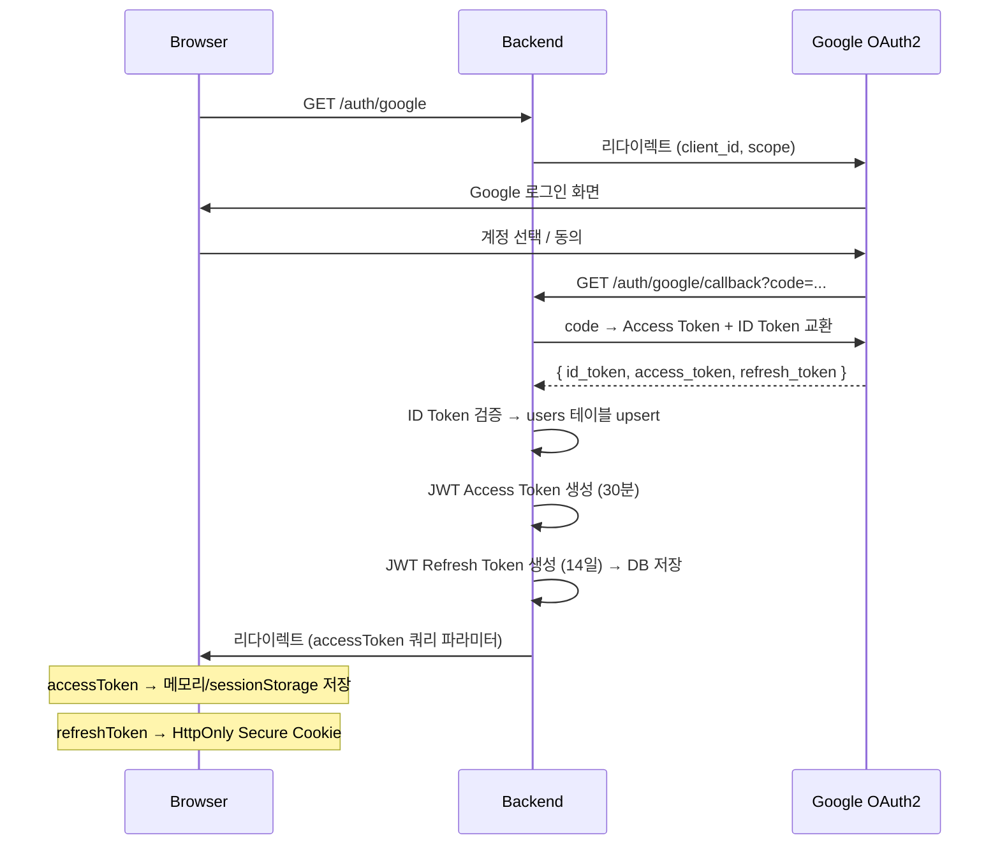

# 시스템 아키텍처

> 최종 업데이트: 2026-10-15

---

## 1. 전체 구조 개요

```
┌─────────────────────────────────────────────────────────────┐
│                        클라이언트                             │
│         Web Browser (PC) / Mobile Browser                    │
│              React + Vite + TypeScript                        │
└───────────────────────┬─────────────────────────────────────┘
                        │ HTTPS
                        ▼
┌─────────────────────────────────────────────────────────────┐
│                    AWS CloudFront (CDN)                       │
│                  정적 파일 배포 (S3)                           │
└───────────────────────┬─────────────────────────────────────┘
                        │
                        ▼
┌─────────────────────────────────────────────────────────────┐
│                   AWS ALB (로드 밸런서)                        │
└───────────────────────┬─────────────────────────────────────┘
                        │
                        ▼
┌─────────────────────────────────────────────────────────────┐
│                   AWS EC2 (Backend)                           │
│           Java 17 + Spring Boot 3 Application                 │
│                                                               │
│  ┌──────────────┐  ┌──────────────┐  ┌──────────────────┐   │
│  │  Controller  │→ │   Service    │→ │   Repository     │   │
│  └──────────────┘  └──────────────┘  └──────────────────┘   │
│                                              │               │
│  ┌──────────────────────────────────────┐    │               │
│  │       Spring Security                │    │               │
│  │  (JWT Filter + OAuth2 + RBAC)        │    │               │
│  └──────────────────────────────────────┘    │               │
└──────────────────────────────────────────────┼──────────────┘
                                               │
                    ┌──────────────────────────┼─────────────┐
                    │                          │             │
                    ▼                          ▼             ▼
          ┌──────────────────┐   ┌──────────────────┐  ┌──────────┐
          │   AWS RDS        │   │  Google OAuth2   │  │ Google   │
          │   MySQL 8.x      │   │  (Workspace)     │  │ Calendar │
          └──────────────────┘   └──────────────────┘  │   API    │
                                                        └──────────┘
```

---

## 2. Frontend 아키텍처

### 기술 스택

| 항목 | 선택 |
|------|------|
| 빌드 | Vite |
| 언어 | TypeScript (strict mode) |
| UI 프레임워크 | React 18 |
| 상태 관리 | Zustand (전역), React Query (서버 상태) |
| 라우팅 | React Router v6 |
| 스타일 | Tailwind CSS |
| 다국어 | react-i18next (한/영/일) |
| HTTP 클라이언트 | Axios (인터셉터로 토큰 갱신 처리) |
| 폼 | React Hook Form + Zod |

### 디렉토리 구조

```
src/
├── app/                  # 라우팅, Provider, 전역 레이아웃
├── pages/
│   ├── user/             # 일반 사용자 화면
│   │   ├── attendance/   # 출퇴근, 휴가
│   │   ├── calendar/     # 캘린더
│   │   ├── document/     # 문서 결재
│   │   ├── notice/       # 공지사항
│   │   └── profile/      # 프로필
│   └── admin/            # 관리자 화면 (CEO / ADMIN)
│       ├── attendance/   # 전사 근태 조회
│       ├── document/     # 전사 문서 조회
│       ├── notice/       # 공지 권한 관리
│       └── user/         # 직원 관리
├── components/           # 공용 컴포넌트
├── hooks/                # 커스텀 훅
├── stores/               # Zustand 스토어
├── api/                  # API 호출 함수 (도메인별)
├── types/                # TypeScript 타입 정의
├── utils/                # 유틸리티 함수
└── locales/              # i18n 번역 파일
    ├── ko/
    ├── en/
    └── ja/
```

### 화면 분리 전략

```
/                         로그인 (Google OAuth 리다이렉트)
├── /app/*                일반 사용자 레이아웃 (EMPLOYEE / MANAGER)
│   ├── /app/attendance   근태 관리
│   ├── /app/calendar     캘린더
│   ├── /app/documents    문서 결재
│   ├── /app/notices      공지사항
│   └── /app/profile      프로필
└── /admin/*              관리자 레이아웃 (CEO / ADMIN)
    ├── /admin/attendance 전사 근태
    ├── /admin/documents  전사 문서
    ├── /admin/users      직원 관리
    └── /admin/notices    권한 관리
```

- Route Guard에서 JWT 페이로드의 `role`을 확인해 접근 제어
- `/admin/*` 진입 시 EMPLOYEE / MANAGER는 `/app`으로 리다이렉트

### Access Token 갱신 흐름

```
Axios Request Interceptor
  └─ Authorization: Bearer <accessToken> 헤더 첨부

Axios Response Interceptor
  └─ 401 응답 수신
      └─ POST /auth/refresh (HttpOnly 쿠키의 Refresh Token 자동 전송)
          ├─ 성공 → 새 accessToken 저장 후 원래 요청 재시도
          └─ 실패 → 로그인 페이지로 리다이렉트
```

---

## 3. Backend 아키텍처

### 기술 스택

| 항목 | 선택 |
|------|------|
| 언어 | Java 17 |
| 프레임워크 | Spring Boot 3.x |
| 보안 | Spring Security 6 |
| ORM | Spring Data JPA + Hibernate |
| DB 마이그레이션 | Flyway |
| 빌드 | Gradle |
| API 문서화 | SpringDoc OpenAPI 3 |
| 테스트 | JUnit 5 + Mockito |

### 레이어드 아키텍처

```
┌───────────────────────────────────────────────┐
│  Controller Layer                              │
│  - HTTP 요청/응답 처리                           │
│  - @Valid 입력 검증                             │
│  - ApiResponse<T> 래퍼로 응답 통일              │
└───────────────────────┬───────────────────────┘
                        │
┌───────────────────────▼───────────────────────┐
│  Service Layer                                │
│  - 비즈니스 로직                                │
│  - 트랜잭션 관리 (@Transactional)               │
│  - 도메인 이벤트 발행                            │
└───────────────────────┬───────────────────────┘
                        │
┌───────────────────────▼───────────────────────┐
│  Repository Layer                             │
│  - JpaRepository 기반 DB 접근                  │
│  - 복잡한 조회는 QueryDSL 또는 @Query 사용       │
└───────────────────────────────────────────────┘
```

### 패키지 구조

```
com.ongs.intranet/
├── common/
│   ├── response/         # ApiResponse, ApiError
│   ├── exception/        # GlobalExceptionHandler
│   └── security/         # JWT 필터, OAuth2 핸들러
├── domain/
│   ├── user/             # 사용자, 부서
│   ├── attendance/       # 근태 (일정, 기록, 휴가)
│   ├── notice/           # 공지사항
│   ├── document/         # 문서 결재
│   └── calendar/         # 캘린더
└── infra/
    ├── google/           # Google OAuth2, Calendar API 클라이언트
    └── persistence/      # JPA 설정, Flyway
```

### 공통 응답 포맷 (변경 금지)

```json
{
  "success": true,
  "data": { ... },
  "error": null
}
```

에러 시:

```json
{
  "success": false,
  "data": null,
  "error": {
    "code": "LEAVE_BALANCE_INSUFFICIENT",
    "message": "연차 잔여일수가 부족합니다."
  }
}
```

---

## 4. 인증 아키텍처

### Google OAuth2 + JWT 흐름



### JWT 페이로드 구조

```json
{
  "sub": "12345",
  "email": "user@company.com",
  "role": "EMPLOYEE",
  "name": "홍길동",
  "iat": 1729000000,
  "exp": 1729001800
}
```

### Spring Security 필터 체인

```
HTTP 요청
  │
  ▼
JwtAuthenticationFilter
  ├─ Authorization 헤더에서 Bearer Token 추출
  ├─ 서명 검증 + 만료 확인
  ├─ SecurityContext에 Authentication 등록
  └─ 인증 실패 → 401 응답
  │
  ▼
RoleBasedAccessControl (@PreAuthorize)
  ├─ ADMIN 전용: @PreAuthorize("hasRole('ADMIN')")
  ├─ CEO 이상: @PreAuthorize("hasAnyRole('CEO','ADMIN')")
  └─ 인가 실패 → 403 응답
```

---

## 5. DB 아키텍처

### MySQL 설정

| 항목 | 값 |
|------|-----|
| 엔진 | InnoDB |
| 문자셋 | utf8mb4 |
| Collation | utf8mb4_unicode_ci |
| 타임존 | Asia/Seoul |

### 스키마 관리 (Flyway)

```
src/main/resources/db/migration/
├── V1__init_schema.sql          # 초기 테이블 생성
├── V2__add_leave_types.sql      # 기본 휴가 유형 데이터
└── V3__...
```

- 운영 환경에서는 `spring.flyway.validate-on-migrate=true` 필수
- ERD 핵심 엔티티 변경 시 새 마이그레이션 파일 추가 (기존 파일 수정 금지)

### 인덱스 전략

| 테이블 | 인덱스 |
|--------|--------|
| users | email, google_id |
| attendance_records | (user_id, work_date) |
| work_schedules | (user_id, work_date) |
| leave_requests | (user_id, status), (approved_by, status) |
| notices | (department_id, deleted_at, created_at) |
| documents | (author_id, status), (status, created_at) |
| approval_lines | (document_id, order_seq), (approver_id, status) |
| calendar_events | (user_id, start_at, end_at) |

---

## 6. AWS 배포 아키텍처

```
┌────────────────────────────────────────────────────────────┐
│                        Route 53                             │
│               ongsIntranet.com → CloudFront                 │
│               api.ongsIntranet.com → ALB                    │
└────────────────────────────────────────────────────────────┘

┌────────────────┐        ┌─────────────────────────────────┐
│  CloudFront    │        │          VPC                     │
│  + S3 Bucket   │        │  ┌──────────────────────────┐   │
│  (React 빌드)  │        │  │   Public Subnet           │   │
└────────────────┘        │  │   ALB (80/443)            │   │
                          │  └──────────┬───────────────┘   │
                          │             │                    │
                          │  ┌──────────▼───────────────┐   │
                          │  │   Private Subnet          │   │
                          │  │   EC2 (Spring Boot App)   │   │
                          │  │   (t3.medium 이상)        │   │
                          │  └──────────┬───────────────┘   │
                          │             │                    │
                          │  ┌──────────▼───────────────┐   │
                          │  │   Private Subnet          │   │
                          │  │   RDS MySQL 8.x           │   │
                          │  │   (db.t3.medium)          │   │
                          │  └──────────────────────────┘   │
                          └─────────────────────────────────┘

┌────────────────────────────────────────────────────────────┐
│  AWS Certificate Manager (ACM): SSL/TLS 인증서             │
│  AWS Secrets Manager: DB 비밀번호, JWT Secret Key,          │
│                       Google Calendar Refresh Token         │
└────────────────────────────────────────────────────────────┘
```

### 환경 분리

| 환경 | 용도 | 비고 |
|------|------|------|
| local | 개발자 로컬 | H2 또는 로컬 MySQL |
| dev | 개발 서버 | EC2 + RDS dev |
| prod | 운영 서버 | EC2 + RDS prod |

### 환경 변수 관리

민감 정보는 코드에 포함하지 않고 AWS Secrets Manager에서 주입:

```
GOOGLE_CLIENT_ID
GOOGLE_CLIENT_SECRET
JWT_SECRET_KEY
DB_URL / DB_USERNAME / DB_PASSWORD
```

---

## 7. Google 연동 아키텍처

### Google Workspace 연동 범위

| API | 용도 | OAuth Scope |
|-----|------|-------------|
| Google OAuth2 | 로그인, 직원 인증 | openid, email, profile |
| Google Calendar API | 캘린더 이벤트 동기화 | https://www.googleapis.com/auth/calendar |

### Calendar 동기화 전략

```
이벤트 생성/수정/삭제
  │
  ▼
로컬 DB 저장 (sync_status = LOCAL)
  │
  ▼
Google Calendar API 호출 (비동기)
  ├─ 성공 → sync_status = SYNCED, google_event_id 저장
  └─ 실패 → sync_status = SYNC_FAILED
              → 재시도 스케줄러 (@Scheduled, 1시간 주기)
```

- Google Calendar Refresh Token은 users 테이블에 암호화(AES-256) 저장
- Google API 호출 실패가 서비스 전체를 막지 않도록 비동기 처리

---

## 8. 보안 고려사항

| 항목 | 대책 |
|------|------|
| Access Token 탈취 | 만료 시간 30분, HTTPS 전송 |
| Refresh Token 탈취 | HttpOnly Secure Cookie, DB에서 무효화 가능 |
| Google Calendar Token | AES-256 암호화 후 DB 저장 |
| SQL Injection | JPA PreparedStatement 사용 |
| XSS | React 기본 이스케이프, Content-Security-Policy 헤더 |
| CSRF | JWT 방식이므로 쿠키 기반 CSRF 불필요 (Refresh Token 쿠키는 SameSite=Strict) |
| 수평적 권한 상승 | Service Layer에서 userId 일치 여부 검증 |
| 민감 정보 노출 | google_calendar_refresh_token 응답 미포함 |

---

## 9. 다국어 (i18n) 아키텍처

### Frontend

- `react-i18next` 사용
- 언어 파일: `src/locales/{ko,en,ja}/translation.json`
- 브라우저 언어 자동 감지 → 미지원 시 한국어(ko) 기본값
- 사용자 언어 설정은 localStorage에 저장

### Backend

- 에러 메시지: `messages_{ko,en,ja}.properties`
- API 요청의 `Accept-Language` 헤더로 응답 언어 결정
- DB 데이터(공지사항 본문 등)는 다국어 미지원 (작성 언어 그대로 저장)

---

## 10. 주요 설계 결정

자세한 내역은 [docs/decisions/](decisions/) 참조.

| 결정 | 선택 | 이유 |
|------|------|------|
| 인증 방식 | Google OAuth2 + JWT | Google Workspace 조직이므로 별도 계정 관리 불필요 |
| Refresh Token 저장 | HttpOnly Cookie | XSS 공격으로부터 토큰 보호 |
| 화면 분리 | URL prefix (/app, /admin) | 역할별 레이아웃·메뉴 구조가 상이함 |
| Calendar 동기화 | 비동기 + 재시도 | Google API 지연이 서비스에 영향 주지 않도록 |
| Soft Delete | notices 테이블 | 삭제된 공지 복원 가능성 및 감사 로그 |
| ERD 변경 정책 | Flyway 마이그레이션 | 스키마 변경 이력 추적 |
